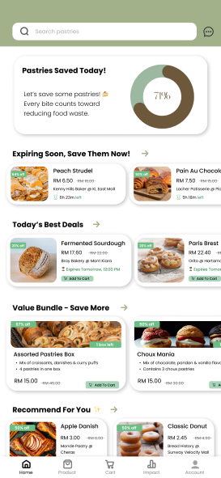

# zerowaste

## About the Project

ZeroWaste is a UI/UX mobile app prototype designed to reduce food waste by connecting consumers with bakeries selling surplus pastries at discounted prices. It features product browsing, shopping cart, checkout, order tracking, AI assistance, and sustainability impact analytics to encourage affordable and sustainable consumption.

## Design Preview

## Design Preview

### Homepage

### Product Category

### Shopping Cart

### Order Tracking

### Sustainability Impact

## Interactive Prototype

[View ZeroWaste Figma Prototype](https://www.figma.com/proto/G8IOfxT7cj0XPGaXHaAw1u/ZEROWASTE-ICT552?node-id=326-201&p=f&t=BHB0eFnWkyWvRKCD-1&scaling=scale-down&content-scaling=fixed&page-id=0%3A1&starting-point-node-id=326%3A201)

## Tools Used
- Figma
- UI/UX Design
- Wireframing
- Interactive Prototyping
